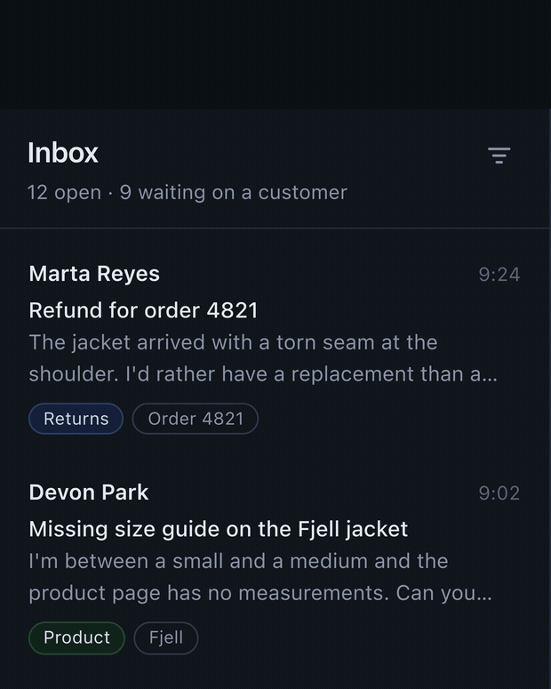

# demo-director

**Product demo videos that don't look generated.** A skill for coding agents: it
plans the film as a storyboard, then builds a frame-accurate video from code, either
a faithful walkthrough of a real-looking app, or a motion-design piece that is not a
walkthrough at all.

https://github.com/user-attachments/assets/1e06deb8-fed8-4d7c-b9c7-07c11430bc5d

*Made with this skill: a 35-second launch film for
[code-slowmo](https://github.com/precious112/code-slowmo), planned as a storyboard,
then rendered frame by frame from code. It can make videos like this for your
product too.*

*The skill was distilled from the launch films for
[Caret](https://github.com/precious112/caret-desktop), a free, open-source design
canvas over your real code. That campaign is included as a case study in
`skills/demo-director/assets/examples/caret/`.*

Most demo tools give you a screen recorder and a template. This gives the agent a
director's rules and a render kit: real UI density, camera and cursor motion with a
steady hand, honest captions, and a frame-by-frame review before anything ships.

## The two films

**A walkthrough.** The product's own screen, simulated faithfully, used in the real
order. The camera and cursor do the explaining.



**A motion-design piece.** The product appears, but composition, type and rhythm
carry the film. Not every launch is a feature tour. The code-slowmo film at the top
is this mode; its full source is in `skills/demo-director/assets/examples/code-slowmo/`.

The skill decides between **walkthrough**, **motion design** and **hybrid**, says
which it chose and why, and holds to what that mode allows. A motion-design film is
not a walkthrough with fancier cards, and a walkthrough is not an ad that keeps
stopping to tour a menu.

## Storyboard first

The skill works as plan mode. It writes a `plan.json`, builds one review page with
the thesis, the beat sheet, key frames and the captions, and waits for approval.

```bash
node scripts/build-storyboard.mjs plan.json   # → storyboard.html
```

You get the one idea, the runtime, the formats, and two or three decisions, not a
wall of prose. Approve it, change it, or tell it to **build it anyway**: the skill
then renders a set of key stills first, says it skipped the plan, and goes straight
to a preview. A full master is never rendered behind your back.

## Install

**Claude Code, Codex, Cursor and other agents that support skills**

```
npx skills add precious112/demo-director
```

To pick the agent yourself, add `-a`, for example `-a claude-code`.

**Claude Code, as a plugin**

```
/plugin marketplace add precious112/demo-director
/plugin install demo-director@demo-director
```

**OpenCode**

```
npx skills add precious112/demo-director -a opencode        # this project
npx skills add precious112/demo-director -a opencode -g     # every project
```

OpenCode finds the skill on its own. Ask for a video, or type `/demo-director`. If
`opencode.json` limits skills with `permission.skill`, allow `demo-director`.

**By hand, for any agent:** copy `skills/demo-director/` into your agent's skills
folder (for Claude Code, `~/.claude/skills/`).

### Requirements

- Node 18+
- ffmpeg on the PATH
- Playwright with chromium (`npm i -D playwright` then `npx playwright install chromium`)

The storyboard needs Node only. Animation and video need all three.

## Use

Ask in your own words:

- "Make a 25-second product demo. The app is in this repo; make it look real."
- "Walk through how a user connects a bank account."
- "We need a motion-design promo for our CLI tool. Not a screen recording."
- "Storyboard it first. I want to review before you render."
- "Turn this launch post into a 15-second vertical clip."

The agent reads the product, picks a mode, writes the plan, and waits. After approval
it builds the stage, renders stills, fixes what the review finds, then renders the
master in each format.

You get: the master, the second aspect ratio cut from the same script, short
cutdowns, a GIF or poster, the stills, the plan and the source. Everything stays
editable: the film is code.

## What it refuses to do

These are the tells that make a demo look AI-made, and the skill treats them as
errors:

- **Toy UI inside the app frame.** Scaled-up text, missing chrome, grey placeholder
  bars, "Acme", a floating tilted window. Real components, real strings, real
  density; readability comes from the camera.
- **Fake capability.** A scripted simulation may remove errors and waiting, never add
  a feature. Compressed time is shown, not hidden. No invented numbers, testimonials
  or customers.
- **Decorated walkthroughs.** Glows, gradient orbs, floating feature cards, bento
  grids, kinetic-type cascades, sparkles, emoji, a logo that spins. The slop list is
  in `references/motion-design.md`.
- **Copy that could describe anything.** No *supercharge, unleash, seamless,
  effortless, empower, streamline, reimagine*. A checker fails the build on them.
- **Unwatched renders.** Every film gets a still at a fixed interval, a contact sheet,
  and a 0.25x pass around every move, because that is where the jumps and overlaps
  are.

## How it works

1. **Plan.** One thesis, a beat sheet with timecodes, camera and action notes, real
   captions, and key frames. Built into a review page.
2. **Stage.** The product's screen as HTML/CSS/JS at its own density, or a
   self-contained composed stage for motion design. A scripted backend feeds real
   components; the app is not actually run.
3. **Render.** Playwright drives a paused virtual clock; every CSS animation is
   seeked per frame; ffmpeg encodes the PNG stream. 60fps, 2x, H.264. The same script
   renders 9:16, 4:5 and 16:9.
4. **Review.** Stills at a fixed interval, a contact sheet, a 0.25x pass around moves,
   a copy check, an honesty check, and WCAG's three-flash limit.

The renderer is deterministic: the same script produces the same frames on every
machine, and a change of one camera move does not perturb anything else.

## What's inside

```
skills/demo-director/
├── SKILL.md                     the workflow the agent follows
├── references/
│   ├── modes.md                 walkthrough vs motion design vs hybrid
│   ├── direction.md             the one idea, structure, runtime, honesty
│   ├── storyboard.md            plan.json, the review page, the approval gate
│   ├── fidelity.md              inside the app frame: no toy UI
│   ├── camera.md                camera, cursor, typing, the stage contract
│   ├── motion-design.md         type, rhythm, transitions, the slop list
│   ├── copy.md                  captions and the banned words
│   ├── rendering.md             the engine, formats, encoding, project layout
│   ├── review.md                the frame, motion and accessibility checks
│   └── research.md              the sources behind the rules
├── scripts/
│   ├── engine.mjs               the frame-accurate renderer
│   ├── build-storyboard.mjs     plan → review page
│   ├── new-project.mjs          scaffold a film
│   ├── check-copy.mjs           the caption checker
│   ├── contact-sheet.mjs        stills → one review image
│   └── to-gif.mjs               mp4 → GIF with a two-pass palette
├── assets/
│   ├── stage/                   the stage shell to copy into a project
│   └── examples/
│       ├── walkthrough/         Harbor: a complete, runnable walkthrough
│       ├── code-slowmo/         a complete, runnable motion-design promo
│       └── caret/               a real launch campaign, as a case study
```

The walkthrough example is end to end: `plan.json`, the storyboard it builds, a dense
support-desk world and a film script. The master is not committed; render it:

```bash
npm install
npm run example:still      # stills every 0.5s
npm run example:render     # 4:5 master
npm run example:render:wide
```

The motion-design example is a self-contained stage that draws every frame from
`seek(t)`:

```bash
node skills/demo-director/assets/examples/code-slowmo/film/render.mjs p
```

## The research behind it

The rules are not taste alone. They draw on NN/g's motion-duration research and
video-usability work, IBM Carbon's productive/expressive motion system, Material's
transition patterns, Apple's motion guidance, WCAG 2.3.1, and current product-demo
data on runtime, structure and sound-off viewing, plus the camera language the
owner approved after the first Caret film. Sources and specifics are in
[`references/research.md`](skills/demo-director/references/research.md).

## Attribution

The code-slowmo promo is © precious112, MIT. The Caret campaign is a case study of
the Caret product (Apache-2.0); its storyboard stills use Unsplash photographs under
the Unsplash License. Harbor is a fictional product. See [`NOTICE.md`](NOTICE.md).

## License

MIT. See [`LICENSE`](LICENSE).
